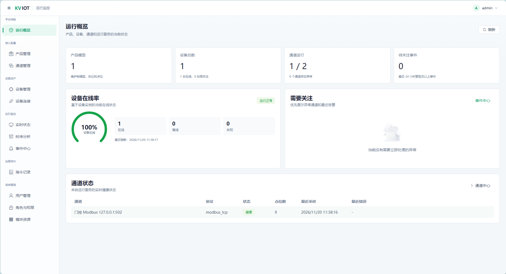
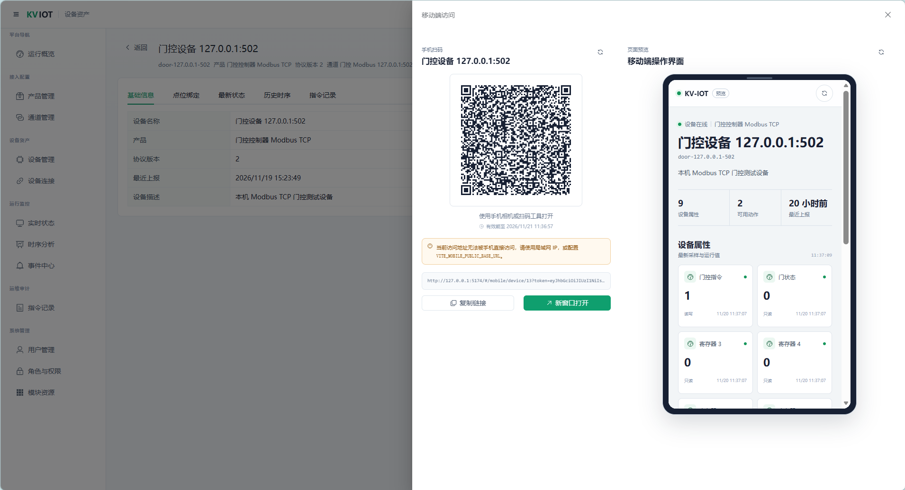
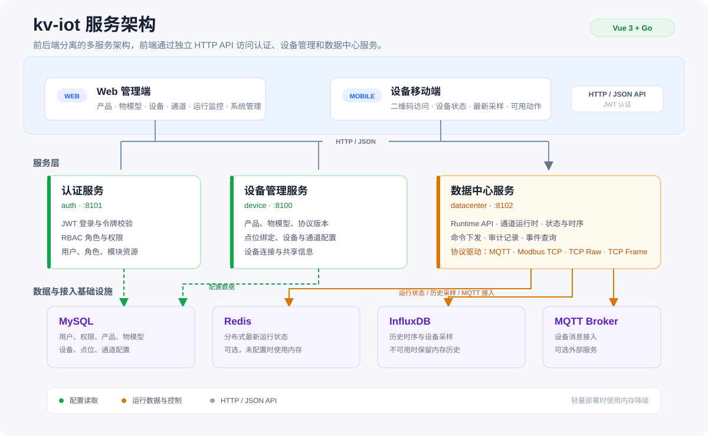
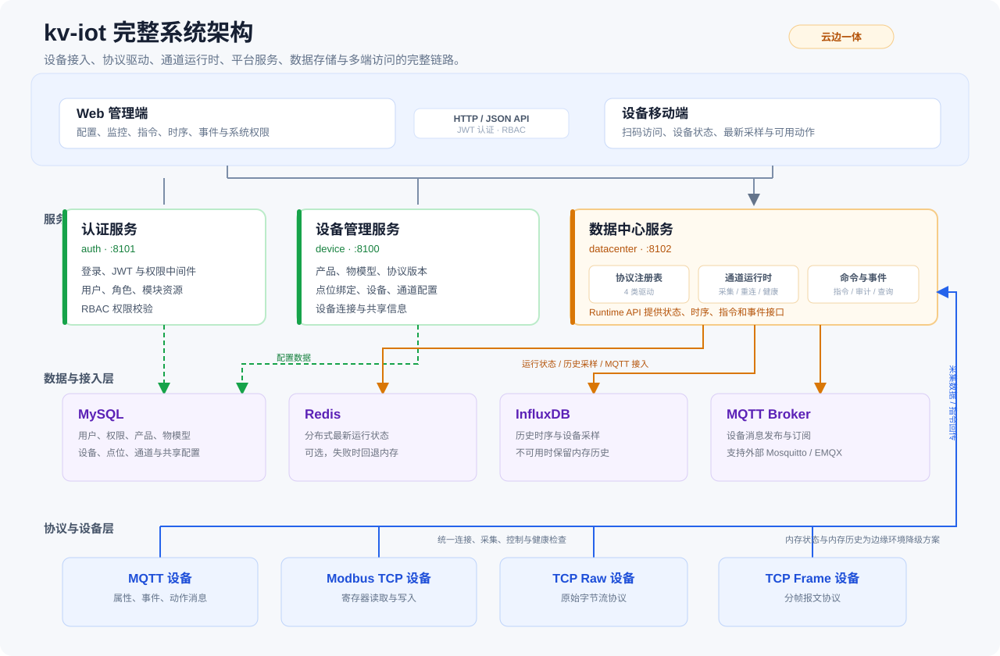

<h1 align="center">🎊🥂 Welcome to kv-iot 👋</h1>
<p>
  
  <a href="https://github.com/kissvivi/kv-iot/blob/main/LICENSE" target="_blank">
    
  </a>
  <a href="https://github.com/kissvivi/kv-iot/issues" target="_blank">
    
  </a>
  <a href="https://github.com/kissvivi/kv-iot/network" target="_blank">
    
  </a>
  <a href="https://github.com/kissvivi/kv-iot/stargazers" target="_blank">
    
  </a>
</p>

> 云边一体化物联网平台 - Go语言开发的轻量级部署解决方案，既可部署到边缘设备也可扩展成企业级物联网平台。

## 🖥️ 系统预览

### 运行概览

<p align="center">
  <a href="docs/images/system-overview.png">
    
  </a>
</p>

_运行概览：集中展示产品、设备、通道、在线率和待关注事件，并直接进入异常设备、通道状态和事件中心。_

### 设备与移动端

<p align="center">
  <a href="docs/images/device-mobile-access.png">
    
  </a>
</p>

_设备详情与移动端：在桌面端查看设备属性、点位和最近采样，通过二维码或访问链接打开同一设备的移动端操作界面。_

## 💡 系统介绍

KV-IOT 是一套前后端分离的云边一体化物联网平台。平台以“产品与物模型 -> 协议版本 -> 点位绑定 -> 通道与设备 -> 运行监控”为主线，覆盖设备接入、数据采集、状态查看、远程控制、历史查询和事件排查等完整流程。

后端使用 Go 构建认证、设备管理和数据中心服务；前端使用 Vue 3 + TypeScript + Vite，同时提供桌面管理端和设备移动端。平台支持 MySQL、InfluxDB、Redis 和 MQTT，并可在资源受限的边缘环境中使用内存状态与内存历史作为降级方案。

## 📅 功能特性

### 已实现功能

1. **认证与权限管理**
   - 用户登录、JWT令牌认证
   - 基于RBAC的角色、模块和权限管理
2. **产品与物模型**
   - 产品、属性、动作和事件管理
   - 物模型Schema生成与设备数据校验
   - 协议版本、点位定义与产品/设备点位绑定
3. **设备与通道管理**
   - 设备档案、设备连接和设备共享管理
   - 通道实例创建、启停、重启、测试和状态查看
   - 支持MQTT、Modbus TCP、TCP Raw、TCP Frame协议驱动
4. **数据中心与运行控制**
   - 周期性采集、统一数据格式和通道健康状态
   - 最新状态、实时读值、历史时序、指令记录和事件查询
   - 指令下发、超时控制、执行结果回读和审计记录
5. **存储与多端访问**
   - MySQL存储配置数据，InfluxDB存储历史时序数据
   - Redis保存分布式运行状态，未配置时自动回退到内存
   - Vue桌面管理端和设备移动端，支持二维码扫码访问
6. **配置与部署**
   - YAML统一配置管理
   - 支持本地开发和Docker容器化部署

### 规划功能

1. **Agent 助手与智能调试**
   - 通过自然语言操控平台页面
   - 引导完成产品、协议版本、点位、通道和设备创建
   - 自动执行通道测试、指令下发、状态与时序核对
   - 页面操作支持步骤预览、用户确认、审计和回滚
2. **规则引擎与告警**
   - 规则转发
   - 数据流转
   - 任务流编排
   - 告警通知与事件处置闭环
3. **更多通讯协议**
   - HTTP设备接入
   - LoRaWAN
   - WebSocket实时推送
4. **API与服务治理**
   - RESTful API网关
   - API文档与测试
5. **平台运维**
   - 日志管理
   - 系统监控
   - 高可用与水平扩展

## 🗺️ 后续计划

后续重点是把平台从“人工配置”推进到“Agent 辅助配置与调试”，同时保证所有页面操作可控、可追踪、可撤销。

### Agent 助手

- 理解用户对设备类型、通信协议和调试目标的自然语言描述
- 操控平台页面完成产品、物模型、协议版本、点位绑定、通道和设备创建
- 启动通道并执行点位测试、指令下发、状态读取和时序核对
- 聚合通道状态、错误信息和事件，给出失败原因与下一步建议
- 每一步写操作都支持预览、用户确认、审计记录和失败回滚
- 严格继承当前用户权限，不允许代理绕过RBAC

### 阶段路线

1. **Agent 基础能力**
   - 增加Agent服务、对话入口和任务执行状态
   - 建立页面上下文、平台上下文和会话记忆
   - 支持任务拆解、参数补全和操作前确认
2. **受控页面操作**
   - 前端提供Agent Action Protocol，暴露导航、填写、选择、提交和校验动作
   - Agent只调用白名单动作，不直接执行任意JavaScript
   - 当前操作目标在页面中高亮，并展示执行步骤、结果和失败原因
3. **设备快速接入**
   - 用户通过“帮我添加一台Modbus TCP设备”发起任务
   - Agent引导补充IP、端口、从站地址和点位信息
   - 自动完成产品、协议版本、点位绑定、通道、设备和调试任务
   - 用户确认后启动通道，生成移动端访问入口并执行首次采样
4. **联调与诊断闭环**
   - 自动检查通道连接、点位质量、最新状态和指令回读
   - 根据协议错误、超时和事件信息给出排查建议
   - 支持用户确认后重新执行失败步骤，不影响已完成的配置
5. **模板、批量与自动化**
   - 从成功接入案例沉淀设备模板和调试模板
   - 支持相似设备批量创建、批量测试和差异检查
   - 预留定时巡检、异常自愈和运维任务编排能力

### 关键设计

- **页面操作层**：`navigate`、`fill`、`select`、`submit`、`verify` 等结构化动作
- **平台工具层**：产品、设备、通道、时序、指令和事件API
- **上下文层**：页面上下文、平台数据上下文和Agent任务状态
- **安全层**：权限校验、动作白名单、写操作确认、审计日志和回滚机制

## 开发日志

* 2023/03-2023/04 开发通用通讯通道，实现MQTT通讯功能，确保设备可正常接入平台
* 2025/10 完善数据中心服务，增强MQTT连接配置管理和参数解析功能
* 2025/10 优化系统架构，改进配置信息输出显示，增强日志记录和错误处理能力
* 2025/10 完善项目文档，提供更全面的部署和使用指南
* 2026/11 完善运行概览、通道状态、设备移动端访问与整体界面体验
* 持续开发中，欢迎志同道合的朋友一起讨论物联网技术和贡献代码

### ✨ [Demo 体验地址 暂无](127.0.0.1)

### ✨ [kv-iot 文档地址/问题记录](http://doc.kv-iot.cn/)

### 前端开源地址

* https://github.com/kissvivi/kv-iot-web.git

### ✨ InfluxDB数据接入

设备历史采样可写入 InfluxDB 2.x。配置 `datasource.influx` 后，数据中心服务会同时维护最新状态、历史时序和事件数据；InfluxDB 不可用时自动保留内存历史，便于在边缘环境中继续运行。

## 🪄 快速开始

### 环境要求

* Go 1.19+
* MySQL 8.0+
* InfluxDB 2.x（推荐，可选）
* Redis 6.0+（可选，用于运行状态缓存）
* MQTT Broker（接入MQTT设备时需要，如Mosquitto、EMQX）
* Node.js 18+（运行前端时需要）
* Docker (可选，用于容器化部署)

### 开发方式运行

1. **配置文件准备**

   ```sh
   # 在仓库根目录准备 config.yaml
   # 按实际环境修改 MySQL、InfluxDB、Redis、MQTT 和服务端口等配置
   ```
2. **安装依赖**

   ```sh
   go mod tidy
   go mod vendor
   ```
3. **运行认证服务**

   ```sh
   go build -o auth cmd/auth/main.go
   ./auth
   ```
4. **运行设备管理服务**

   ```sh
   go build -o device cmd/device/main.go
   ./device
   ```
5. **运行数据中心服务**

   ```sh
   go build -o datacenter cmd/datacenter/main.go
   ./datacenter run
   ```

### Docker容器化部署

1. **构建Docker镜像**

   ```sh
   go mod tidy
   go mod vendor
   make dockers
   ```
2. **使用Docker Compose运行**

   ```sh
   cd docker
   docker-compose up -d
   ```

   当前 `docker-compose.yml` 主要启动认证服务、设备管理服务和 MySQL。数据中心服务可继续通过 `./datacenter run` 独立运行，并连接外部的 MySQL、InfluxDB、Redis 和 MQTT 服务。

### 配置说明

项目主要通过 `config.yaml`文件进行配置，包括：

- 数据库连接参数
- MQTT连接配置
- Redis运行状态配置
- InfluxDB时序存储配置
- 服务端口和其他运行时参数

详细配置说明请参考配置文件注释或文档。

## 📝 系统架构

### 服务架构



### 完整系统架构



### 系统组件说明

#### 1. 设备层
- 支持MQTT、Modbus TCP、TCP Raw、TCP Frame协议设备接入
- 设备通过相应协议上报属性、事件和执行平台下发的动作
- 仓库内提供模拟设备和协议测试工具，用于本地联调和演示

#### 2. 数据中心服务 (核心衔接组件)
- **协议驱动**: 按统一接口注册和创建MQTT、Modbus TCP、TCP Raw、TCP Frame驱动
- **通道运行时**: 负责连接建立、周期采集、重连、健康检查和并发控制
- **设备认证**: 验证设备身份和权限
- **数据转换**: 将不同协议数据统一为属性和事件采样
- **设备同步调度器**: 定期从设备管理服务同步设备信息
- **运行能力**: 提供最新状态、时序查询、指令下发、审计记录和事件查询
- **核心职责**: 连接设备层与后端服务，是整个系统的中枢

#### 3. 服务层
- **认证服务**: 提供用户认证、角色管理和权限控制
- **设备管理服务**: 管理产品、物模型、协议版本、点位绑定、设备和通道配置
- **规则引擎服务**: 实现数据处理规则和业务逻辑编排（规划中）

#### 4. 数据存储层
- **MySQL**: 存储用户、权限、产品、物模型、设备、点位和通道配置等结构化数据
- **InfluxDB**: 存储设备上报的历史时序数据
- **Redis**: 可选，保存通道最新状态；未配置时使用进程内存
- **内存存储**: 在边缘环境或外部存储不可用时提供状态、历史和命令缓存降级能力

#### 5. 前端界面
- 提供产品、通道、设备、运行监控和系统管理桌面端
- 提供设备移动端，可通过二维码或访问链接查看状态并执行设备动作
- 通过认证服务完成登录，通过设备服务和数据中心API获取配置与运行数据

### 数据流转流程
1. 用户在设备管理服务中完成产品、物模型、协议版本、点位绑定、设备和通道配置
2. 数据中心服务读取已启用通道，并通过对应协议驱动建立连接
3. 通道运行时周期采集设备数据，或将设备主动上报的数据转换为统一采样格式
4. 最新采样写入状态存储，历史采样写入InfluxDB或内存历史，异常和事件写入事件存储
5. 前端通过认证、设备管理和数据中心API展示运行状态、时序、指令和事件
6. 用户下发指令后，数据中心通过目标通道执行、回读结果并记录审计信息

### 服务划分

根据功能模块化设计，将系统分为多个独立服务：

- **认证服务（auth）**：负责用户认证、授权和权限管理
- **设备管理服务（device）**：管理产品、物模型、协议、点位、设备和通道配置
- **数据中心服务（datacenter）**：处理协议接入、通道运行、状态、时序、指令和事件
- **规则引擎服务（rule）**：实现数据处理规则和业务逻辑编排（规划中）

### 分层架构

每个服务内部采用清晰的分层结构：

- **data层**：数据模型定义和数据访问操作
  - 包含数据实体、仓储模式实现
  - 数据库连接和事务管理
- **service层**：核心业务逻辑实现
  - 业务规则处理
  - 数据验证和转换
- **endpoint层**：服务接口暴露
  - REST API
  - gRPC接口
  - 消息订阅接口

### 运行时数据流程

1. 数据中心启动时加载已启用通道及其协议配置
2. 协议注册表创建对应驱动，通道管理器为每个通道启动独立运行时
3. 采样Sink将统一格式的数据分发给最新状态、历史时序和实时事件
4. 运行时API向桌面端和移动端提供状态、时序、指令和事件接口
5. 规则引擎接入后，可在Sink和API之间增加数据转发、告警和业务编排能力

### 关于项目

* kv-iot是一个开源的云边一体化物联网平台，综合参考了阿里云物联网平台、中国移动ONE-NET、IotDc3、JetLinks、ChirpStack等优秀项目的设计理念
* 项目采用轻量级设计，可灵活部署于边缘设备或云服务器，满足不同规模的物联网应用需求
* 我们致力于打造一个简单易用、功能强大、性能稳定的物联网开发框架

### 交流与支持

* QQ交流群：442183314
* 欢迎提交Issue和Pull Request
* 欢迎分享您的使用案例和改进建议

## Author

👤 **jobs_vivi**

* Twitter: [@jobsvivi](https://twitter.com/jobsvivi)
* Github: [@kissvivi](https://github.com/kissvivi)

## Show your support

Give a ⭐️ if this project helped you!

## Thanks 感谢支持

### 感谢赞助

<a href="https://jb.gg/OpenSourceSupport">

</a>

### 感谢Trae AI

特别感谢Trae AI提供的强大开发辅助功能，在代码完善、文档撰写和系统优化方面提供了重要支持，大幅提升了开发效率和代码质量。

### 感谢Codex与ChatGPT

特别感谢 Codex 与 ChatGPT 在代码分析、功能实现、问题排查、文档撰写和界面完善过程中提供的支持，帮助提升了开发效率与交付质量。

### 感谢社区贡献

感谢所有关注和支持本项目的开发者，欢迎提交Issue和Pull Request，共同建设更好的物联网平台。

## 📝 License

Copyright © 2022 [jobs_vivi](https://github.com/kissvivi).`<br />`
This project is [Apache License](https://github.com/kissvivi/kv-iot/blob/main/LICENSE) licensed.

---

_This README was generated with ❤️ by [readme-md-generator](https://github.com/kefranabg/readme-md-generator)_
